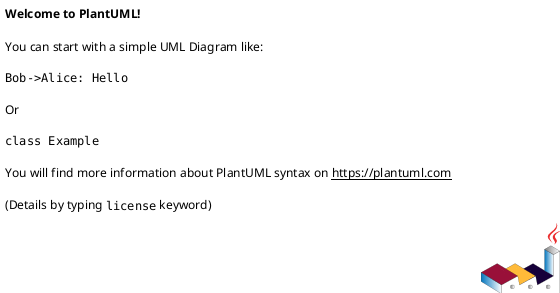

# Draw.io Import Guide - VibraMeet Flowcharts

## Overview

All flowchart and architecture diagrams have been exported in **PlantUML** format, which is natively supported by draw.io and many other diagramming tools.

## Files Available

### 1. **FLOWCHART_DRAWIO.puml**
- Complete application workflow
- User login, navigation, and feature flows
- Event management and registration process
- Admin functions and penalties
- Statistics and request management

### 2. **DATABASE_MODEL_DRAWIO.puml**
- UML class diagram of all data models
- Entity relationships
- Enums and field definitions
- All database tables and their connections

### 3. **SYSTEM_ARCHITECTURE_DRAWIO.puml**
- Frontend components
- Backend API routes
- Prisma ORM layer
- Database tables
- External services and integrations

### 4. **REGISTRATION_WAITLIST_DRAWIO.puml**
- Registration workflow
- Smart waitlist algorithm
- Admin management flow
- Penalty checking
- Payment flow
- Notification system

## How to Import into Draw.io

### Method 1: Import from File (Recommended)

1. Go to [draw.io](https://app.diagrams.net) or open your local draw.io
2. Click **File** → **Import from** → **URL** (or paste from file)
3. Copy the entire content of one of the `.puml` files
4. Paste it in the import dialog
5. Select **PlantUML** as the diagram type
6. Click **Import**
7. Draw.io will automatically convert to editable diagram

### Method 2: Direct URL Import

If files are in a GitHub repo or accessible URL:

1. Click **File** → **Import from** → **URL**
2. Enter the raw URL to the `.puml` file
3. Draw.io converts it automatically

### Method 3: Create from PlantUML Extension

1. Install Draw.io desktop application
2. Use the PlantUML extension/plugin
3. Open `.puml` file directly
4. Auto-converts to editable diagram

## PlantUML Syntax Features Used

The diagrams use:



## Customizing Diagrams in Draw.io

Once imported, you can:

- **Edit text**: Double-click any element
- **Change colors**: Right-click → **Edit style**
- **Resize**: Drag corners
- **Add notes**: Insert text boxes
- **Export**: File → **Export as** (PNG, SVG, PDF)
- **Print**: File → **Print**

## Common Issues & Solutions

### Issue: PlantUML content not recognized
**Solution**: Copy-paste the PlantUML content directly into Draw.io's text editor

### Issue: Diagram appears too large/small
**Solution**: Use the Zoom controls (+ / -) in Draw.io toolbar

### Issue: Some symbols not rendering
**Solution**: Some symbols may render differently. Redraw with native shapes

## Alternative Tools

These PlantUML files also work with:

- **Visual Studio Code**: PlantUML extension
- **Plant-UML Online Editor**: [plantuml.com/plantuml](https://www.plantuml.com/plantuml)
- **Lucidchart**: Has PlantUML import support
- **OmniGraffle**: Supports PlantUML
- **Miro**: Can import PlantUML diagrams

## Converting to Other Formats

### From PlantUML to Other Formats:

```bash
# Install PlantUML CLI (if not already installed)
sudo apt install plantuml

# Convert to PNG
plantuml FLOWCHART_DRAWIO.puml -o output.png

# Convert to SVG
plantuml -tsvg FLOWCHART_DRAWIO.puml

# Convert to PDF
plantuml -tpdf FLOWCHART_DRAWIO.puml
```

### Using Online PlantUML Editor:

1. Go to [plantuml.com/plantuml](https://www.plantuml.com/plantuml)
2. Paste the PlantUML content
3. Select output format (PNG, SVG, PDF, EPS, etc.)
4. Download the result

## Using with Version Control

Store diagrams as `.puml` files in Git:

```bash
# Add to repository
git add *.puml
git commit -m "Add VibraMeet flowcharts"
git push

# Collaboration:
# - Multiple people can edit .puml files
# - Version history tracked
# - Easy diffs for changes
# - Lightweight format
```

## Recommended Workflow

1. **Keep `.puml` files** in repository for version control
2. **Import into Draw.io** for interactive editing/visualization
3. **Export as PNG/PDF** for presentations/documentation
4. **Update `.puml` source** when changes are made
5. **Commit changes** to Git

## Examples of What You Can Do

### Test Coverage Mapping
- Map test cases to flowchart states
- Identify untested paths

### Bug Tracking
- Annotate known issues on diagrams
- Link to GitHub issues

### Performance Analysis
- Add timing information to flows
- Identify bottlenecks

### Documentation
- Embed diagrams in README
- Create developer onboarding guides

## Quick Reference

| File | Best For | Key Focus |
|------|----------|-----------|
| FLOWCHART_DRAWIO.puml | Understanding flow | User interactions & processes |
| DATABASE_MODEL_DRAWIO.puml | Data structure | Entities & relationships |
| SYSTEM_ARCHITECTURE_DRAWIO.puml | System design | Components & integration |
| REGISTRATION_WAITLIST_DRAWIO.puml | Specific feature | Smart waitlist logic |

## Need Help?

- **PlantUML Docs**: [plantuml.com](https://plantuml.com)
- **Draw.io Docs**: [about.draw.io](https://about.draw.io)
- **GitHub Issues**: Add issue with diagram links

---

**Created**: March 27, 2026
**Format**: PlantUML (UML)
**Tools**: Draw.io compatible
**Status**: Ready for import and editing
